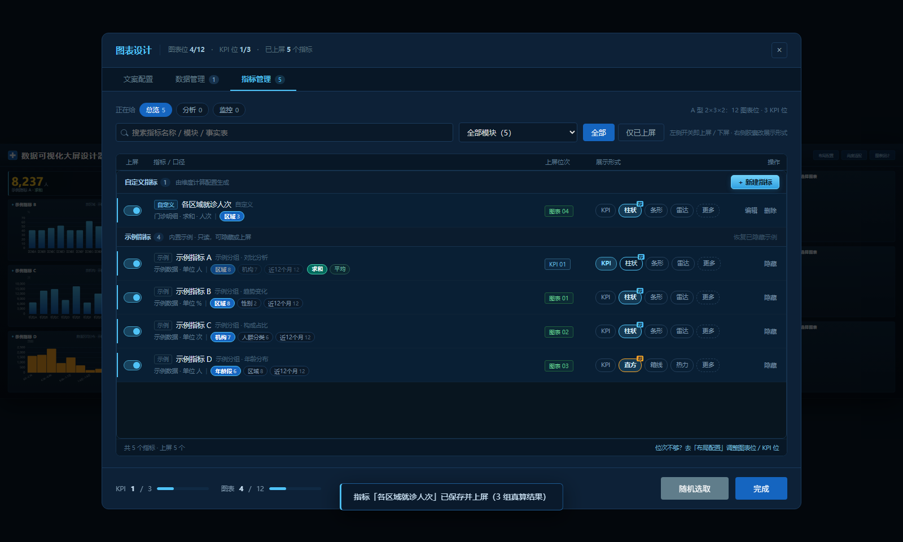
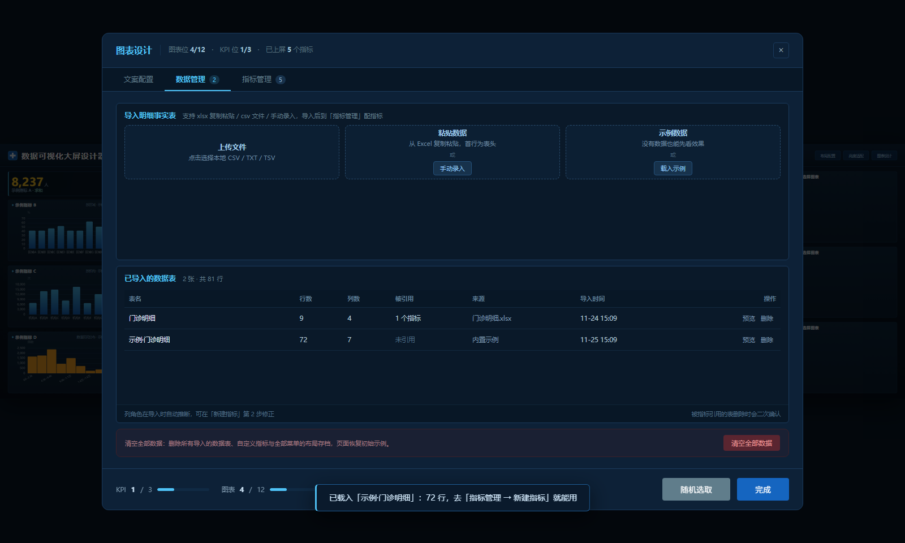
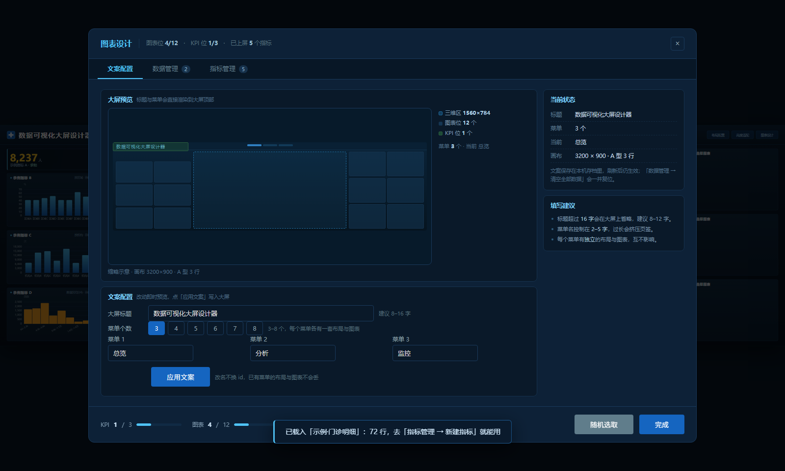
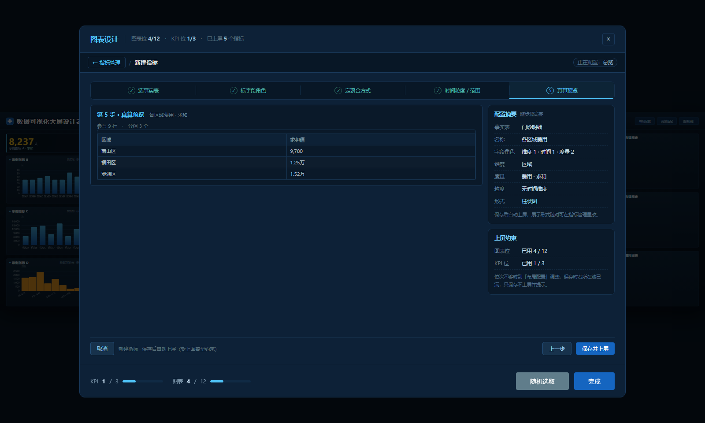

# DesignTools

设计类工具的集合仓库。每个工具自成一个目录，**单文件、离线、双击即用**，不装服务、不连数据库、不联网。

当前收录：

| 工具 | 说明 | 状态 |
|---|---|---|
| [大屏编辑器](./大屏编辑器/) | 数据大屏可视化编辑器：导入明细表 → 算指标 → 配图形 → 自动排版 → 导出单文件大屏 | 可用 |

---

## 大屏编辑器

一个 HTML 文件搞定整套数据大屏。图表引擎、三维地图底图、全部样式和逻辑都封在这一个文件里，拷到任何电脑上用浏览器打开就能跑。

解决三件具体的事：

| 痛点 | 传统做法 | 这个编辑器的做法 |
|---|---|---|
| 换一个统计口径就要改一次报表 | 找开发改 SQL、发版 | 界面上勾几下，几秒钟出新图 |
| 大屏位置全靠手工摆 | 一个个拖、一个个量 | 按画布尺寸自动算出每张卡该在哪 |
| 演示时数据是编的 | 用假数据糊过去 | 导入真实明细表，现场算真数 |

### 核心能力

- **四级流水线**：数据 → 指标 → 维度 → 图形，左边一改右边立刻重画，各级可单独替换
- **自动布局**：按画布尺寸与密度算出每张卡的位置，2×3×2 / 2×2 等版式随指标数量联动，卡片位满即提示
- **三个入口 + 一层钻取**：指标管理 / 维度计算 / 文案配置分三处进，复杂配置走横向 5 步向导
- **口径可追溯**：每个指标带「事实表 · 聚合 · 度量 · 粒度」口径行，示例数据与真实数据两条链路严格隔离
- **手动微调**：拖动、单轴对齐、吸附基准线、撤销栈，重叠自动回滚
- **即时生效**：弹窗内改动立刻落盘并重绘大屏，× 只是关闭，不需要「确定 / 取消」

### 预览

| 指标管理 | 数据管理 |
|---|---|
|  |  |

| 文案配置 | 维度计算 |
|---|---|
|  |  |

### 快速开始

1. 下载 `大屏编辑器/大屏编辑器.html`
2. 双击用浏览器打开（推荐 Chrome / Edge）
3. 顶部菜单进入「图表设计」弹窗，先在「数据管理」导入 CSV 或粘贴表格区域
4. 在「指标管理」勾选要上屏的指标，返回即可看到大屏

仓库自带 `大屏编辑器/样例数据.csv`，也可以直接用弹窗里的「载入示例」按钮，代码内置 72 行示例明细。

---

## 目录结构

```
DesignTools/
├── README.md
└── 大屏编辑器/
    ├── 大屏编辑器.html          # 主程序（单文件，含全部逻辑与样式）
    ├── 大屏编辑器设计方案.md     # 实现原理：18 章，讲规则、公式与取舍
    ├── 大屏布局推算器.html       # 布局算法独立演算页，调参看效果
    ├── 样例数据.csv
    ├── docs/preview/            # 界面截图
    └── 历史稿件/                # 历轮方案与设计稿（决策留痕，非运行依赖）
```

## 文档

- [大屏编辑器设计方案](./大屏编辑器/大屏编辑器设计方案.md)：面向产品 / 业务 / 技术一起看的通用说明，只讲规则、公式和取舍，不涉及实现代码
  - 一 ~ 十三：每一级在算什么（数据、指标、维度、图形、布局、KPI、手动干预、交付、边界）
  - 十四 ~ 十八：界面上长什么样、为什么这么长（界面骨架、三入口、菜单隔离、即时生效与容量护栏、迭代存档）
- [历史稿件](./大屏编辑器/历史稿件/)：逐轮改动方案，每条都带「现状 → 根因 → 改哪里 → 怎么验收」

## 说明

- 主程序为单文件自包含设计：零位图、零外部依赖、零网络请求，交付就是拷一个文件
- `历史稿件` 里的 `*.bak-*.html` 快照不入库，需要时查 git 历史
- 示例数据中的区域 / 机构名称均为虚构
